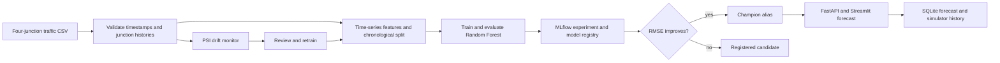

# 🚦 AI-Based Traffic Prediction System with MLOps

**Project 28** · K.Mahija (2400080129) · Sk.Anjum (2400080003) · P.Hasitha (2400080005)

> **Problem statement.** Traffic demand changes by hour, weekday, weather, events, and location. Static estimates cannot respond to changing patterns. This project builds a reproducible lifecycle that validates historical traffic data, predicts the next hour, tracks and versions experiments, monitors input drift, and supports reviewed retraining and deployment.

## Launch the working project

<details open>
<summary><strong>Run locally on Windows</strong></summary>

```powershell
python -m venv .traffic-venv
.\.traffic-venv\Scripts\Activate.ps1
python -m pip install --upgrade pip
pip install -r requirements.txt
python -m traffic_mlops.cli bootstrap
streamlit run app.py
```

Open [the dashboard](http://localhost:8501). Bootstrap validates the bundled CSV, trains/evaluates a baseline model, logs the run and registers/promotes the first champion in MLflow. To start the API and tracking UI in separate activated terminals:

```powershell
uvicorn traffic_mlops.api:app --reload
mlflow ui --backend-store-uri sqlite:///mlflow_project28.db --host 127.0.0.1 --port 5000
```

Then open [API docs](http://localhost:8000/docs) or [MLflow](http://localhost:5000).
</details>

<details>
<summary><strong>Run with Docker Compose</strong></summary>

```powershell
docker compose up --build
```

Dashboard: [localhost:8501](http://localhost:8501) · API: [localhost:8000/docs](http://localhost:8000/docs) · MLflow: [localhost:5000](http://localhost:5000). `mlflow_data` and `app_data` volumes persist model tracking/artifacts and forecast history.
</details>

## Interactive software simulation

Every feature runs in software; no roadside hardware is needed. Operator identity is a session profile rather than an authentication service. The **Simulation lab** generates reproducible virtual sensors, temperature/humidity/rain/light conditions, 5G-style link telemetry, device status, alert events, and online/offline scenarios from the historical junction profiles. Use **Generate next virtual minute** to advance the persisted simulator. Inject a sensor fault or switch the simulated cloud link offline to explore failover.

- **Dashboard and virtual sensors:** per-junction traffic flow, speed, occupancy, environmental readings, sensor health, time-series charts, and alert state.
- **Forecast and virtual signal control:** MLflow champion predicts next-hour traffic. Automatic green-phase suggestions or manual settings update the simulator and are recorded in SQLite; no real controller is contacted.
- **Incident review:** attach/capture a scenario image, classify its type/severity in the operator form, and save a persistent incident report. The numerical congestion-risk score comes from the flow model compared with the junction's historical 95th percentile; it is not an image classifier or calibrated probability.
- **Junction zones:** schematic green/yellow/red status from simulated occupancy, with no coordinates required.
- **AI assistant:** answers questions using junction history, model forecasts, or current virtual telemetry.
- **Edge and network lab:** virtual 5G signal/throughput/latency, simulated edge inference latency, cloud-link toggling, and host-local cached-model inference while offline.
- **Analytics and reports:** historical traffic baseline, persisted virtual sensor/alert history, forecasts, incidents, operator actions, and Markdown/CSV downloads.

Simulator output is labeled virtual. It provides repeatable MLOps demos and failure scenarios; it does not represent live measurements from a deployed road network.

## End-to-end workflow



1. **Data:** load `data/traffic.csv`; clean and validate timestamps, junctions, vehicle counts, and optional fields.
2. **Features:** generate lag 1/2/3/24/168, rolling averages, and calendar cycles per junction. Train/test split is chronological, never randomly shuffled.
3. **Train and evaluate:** fit a scikit-learn Random Forest. Log parameters, MAE, RMSE, R², dataset identity, model signature, and example to MLflow. Dataset changes reset the champion comparison baseline so metrics from different datasets are not compared.
4. **Track and version:** register every model. Alias `champion` moves only when the new holdout RMSE is lower than the existing champion's on the same dataset.
5. **Serve:** FastAPI forecasts the next hour for a known junction. Promoted champions are cached in `edge_cache/` for simulated local inference while the cloud link is down. The dashboard includes virtual sensors, weather/network telemetry, incident and alert simulation, junction zones, virtual signal control, reports, and MLOps.
6. **Monitor and retrain:** PSI compares older and recent feature distributions (0.2 review threshold). Drift is a signal to investigate; it is not a substitute for measuring forecast error against later observed traffic. Train via dashboard or `python -m traffic_mlops.cli train`.

## Data and attribution

The bundled CSV is derived from Kaggle's [Traffic Prediction Dataset](https://www.kaggle.com/datasets/fedesoriano/traffic-prediction-dataset), contributed by `fedesoriano`. The Kaggle data card reports 48,120 hourly vehicle-count observations for four junctions and states educational-use-only/source-confidential terms. Use this copy for this academic project and follow the source page's terms for any redistribution or other use.

`data/raw/kaggle_junction_traffic.zip` is the downloaded archive. `data/traffic.csv` is the prepared training CSV with exactly `timestamp`, `junction`, and `vehicles`. It has **48,120 rows**, no missing required values, unique junction-hour keys, and continuous hourly histories: Junctions 1–3 contain 14,592 rows each; Junction 4 contains 4,344 rows. Junction 4 starts later than the others. No weather fields are present; the application normalizer supplies neutral defaults for model compatibility, while the simulator generates separately labeled synthetic weather values. Verify/rebuild the prepared data with:

```powershell
python scripts/prepare_junction_data.py
```

For your own CSV, required columns are `timestamp`, `junction`, `vehicles`; optional columns are `temperature_c`, `is_event`. Provide continuous hourly observations for at least 168 hours per junction for all lag features. The dashboard uploader validates the schema. Uploaded data is used for that dashboard session; save a dataset as `data/traffic.csv` to use it consistently in the API and CLI.

## API quick reference

| Method | Endpoint | Purpose |
| --- | --- | --- |
| `GET` | `/health` | Service and champion readiness |
| `POST` | `/predict` | Forecast next hour and persist result |
| `POST` | `/train` | Train, evaluate, register, and consider promotion |
| `GET` | `/monitor` | Run feature drift check |
| `GET` | `/predictions?limit=100` | Read persisted forecast history |
| `POST` | `/simulation/tick` | Generate virtual sensors, network, weather, and alert records |
| `GET` | `/simulation/telemetry` | Read saved virtual sensor ticks |
| `GET` | `/simulation/alerts` | Read saved virtual alerts |

Example `POST /predict` body:

```json
{
  "junction": "Junction 1",
  "vehicles": 220,
  "temperature_c": 20,
  "is_event": 0,
  "offline": false
}
```

Use `http://localhost:8000/docs` for interactive OpenAPI requests. Forecast output is a model estimate, not a traffic-control instruction.

## DagsHub experiment tracking (optional)

Local MLflow is the default. To track to a DagsHub repository, create a repository, install the connector, and set credentials in your shell (do not commit tokens):

```powershell
pip install -r requirements-dagshub.txt
$env:DAGSHUB_REPO_OWNER = "your-account"
$env:DAGSHUB_REPO_NAME = "traffic-prediction-project-28"
$env:DAGSHUB_USER_TOKEN = "your-dagshub-token"
python -m traffic_mlops.cli train
```

The integration calls `dagshub.init(..., mlflow=True)` and uses DagsHub's MLflow tracking endpoint. For Docker Compose, copy `.env.example` to `.env`, set `MLFLOW_TRACKING_URI=https://dagshub.com/<owner>/<repository>.mlflow`, `MLFLOW_TRACKING_USERNAME=<owner>`, and `MLFLOW_TRACKING_PASSWORD=<user-token>`. Keep `.env` private. Local Compose uses the bundled MLflow service; local SQLite mode needs no DagsHub account.

## Configuration and persistence

- `MLFLOW_TRACKING_URI`: optional tracking backend; defaults to project-local `mlflow_project28.db` with artifacts in `mlartifacts/project28/`. The starter's earlier `mlflow.db` is left intact.
- `DAGSHUB_REPO_OWNER`, `DAGSHUB_REPO_NAME`, `DAGSHUB_USER_TOKEN`: optional remote tracking credentials.
- `TRAFFIC_APP_DB`: optional SQLite forecast-history file; defaults to `traffic_app.db`.
- The CSV is at `data/traffic.csv`; dataset and database paths can be mounted for deployments.

Before public deployment, configure HTTPS and authentication at the ingress/API gateway, set secret environment variables in the hosting platform, use durable storage for SQLite/MLflow artifacts or a managed backend, and restrict CORS/network access to trusted clients. The sample compose file is a production-style local demo, not a security-hardened public endpoint.

## Project structure

```text
app.py                     Streamlit dashboard
traffic_mlops/api.py       FastAPI prediction and lifecycle API
traffic_mlops/training.py  Chronological training and MLflow registry
traffic_mlops/features.py  Junction-aware time-series feature pipeline
traffic_mlops/monitoring.py PSI drift monitoring
traffic_mlops/history.py   Persistent forecast history (SQLite)
scripts/prepare_junction_data.py Prepare the four-junction CSV
traffic_mlops/simulation.py   Software sensor/network/control simulator
traffic_mlops/history.py     SQLite forecasts/incidents/actions/telemetry
data/traffic.csv           Ready-to-run, prepared dataset
docker-compose.yml         Dashboard, API, MLflow services
```

### Workflow commands

```powershell
python -m traffic_mlops.cli generate-data  # reproducible synthetic fallback
python -m traffic_mlops.cli train
python -m traffic_mlops.cli monitor
python -m traffic_mlops.cli train --data path\to\traffic.csv
```

## Team

**Project title:** AI-Based Traffic Prediction System with MLOps  
**Project number:** 28

| Student ID | Name |
| --- | --- |
| 2400080129 | K.Mahija |
| 2400080003 | Sk.Anjum |
| 2400080005 | P.Hasitha |
